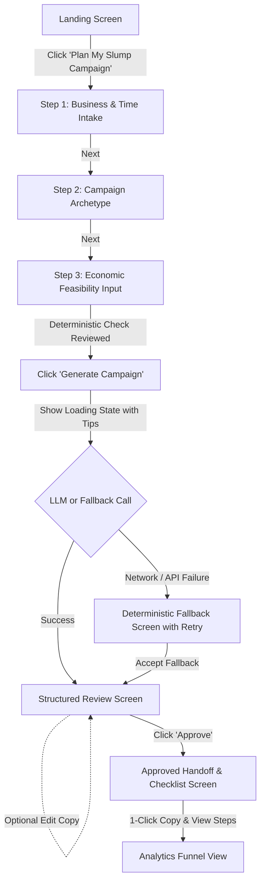

# Product Requirements Document (PRD): GrowthFlow MVP

**Product Name:** GrowthFlow  
**Document Version:** 1.1 (MVP Specification with Phase 2 Rigor Refinements)  
**Author:** APM Candidate  
**Date:** October 14, 2026  
**Status:** Ready for Implementation  

---

## 1. Problem and Objective

### 1.1 Problem Statement
Independent café and bakery owner-operators suffer predictable revenue slumps during weekday afternoons (e.g., Tuesday–Thursday between 2:00 PM and 5:00 PM). While fixed costs (rent, standing labor shifts, espresso machine power) continue to accrue, owners lack the marketing expertise, prompt-engineering skills, and operational bandwidth to formulate a compelling, margin-safe promotional offer and write localized marketing copy.

Existing solutions fail them:
* **Generic LLMs (ChatGPT):** Require prompt engineering, produce clichéd marketing fluff (*"delve"*, *"elevate your experience"*), and hallucinate discounts without knowing restaurant unit contribution margins.
* **Complex SaaS / Ad Suites (Mailchimp, Meta Ads):** Feature-bloated, jargon-heavy, and require pre-existing contact lists or cash ad budgets.

### 1.2 Product Objective
Deliver a specialized, web-based campaign preparation tool that allows an independent café owner to:
1. Define a targeted weekday slump scenario.
2. Mathematically verify the **unit contribution economics** of their promotional offer (accounting for total variable costs of single items or multi-item bundles) before launching.
3. Generate structured, authentic copy across two local formats (Organic Instagram caption and Sidewalk Chalkboard layout).
4. Review, optionally edit, and approve the campaign brief, with 1-click clipboard handoff and an editable, time-relative staff operational checklist.

---

## 2. Target Persona & User Stories

### 2.1 User Persona
* **Name:** Elena
* **Role:** Owner-operator of a neighborhood specialty coffee shop & micro-bakery.
* **Pain Point:** Dead hours on weekday afternoons; wants to drive 10–20 incremental visitors without giving away product at a loss or spending hours on marketing.

### 2.2 Primary User Stories
* **US-1 (Context Input):** As Elena, I want to input my business details (café name, specialty, target weekday hours) into a simple guided form so that the campaign is tailored to my real store situation.
* **US-2 (Bundle Unit Economics):** As Elena, I want to input component prices and variable costs for my promotional offer (e.g., Latte price + Croissant price and their individual COGS), so that I can see the combined promotional unit contribution and breakeven volume before I publish.
* **US-3 (Campaign Generation):** As Elena, I want the system to generate a structured campaign brief with tailored copy for Instagram and my sidewalk chalkboard, avoiding AI clichés.
* **US-4 (Review & In-Line Edit):** As Elena, I want to review the generated copy and have the option to edit the text directly so that it matches my café's voice, without being forced to edit if the draft is already good.
* **US-5 (Time-Relative Handoff & Checklist):** As Elena, I want to copy the formatted text to my clipboard with 1 click, view a staff prep checklist timed relative to my slump start time (with the ability to edit the tasks), and explicitly mark the campaign as approved.

---

## 3. Prioritized Scope & Feature List

### 3.1 Must-Have (MVP Scope)
1. **Guided Scenario Intake:**
   * Step 1: Business Profile & Target Slump (Business Name, Location Vibe, Day/Time window e.g., Tuesday 2–5 PM).
   * Step 2: Campaign Archetype Selection (Bundle Deal, Remote Work Perk, or 2-for-1 Neighbor Offer).
   * Step 3: Menu Item & Economic Parameters (Supports single item or multi-item bundle: Regular Item Price(s), Estimated Variable Cost(s), Promotional Price).
2. **Deterministic Feasibility Engine:**
   * Real-time calculation of Baseline Unit Contribution ($U_{base}$), Promo Unit Contribution ($U_{promo}$), Promotional Contribution Rate ($CR_{\%}$), and Breakeven Volume Multiplier.
   * Red warning flag for negative contribution ($U_{promo} \le 0$) with multiplier rendered as `"Non-viable"`.
   * Yellow advisory for thin contribution ($CR_{\%} < 35\%$, configurable default).
   * Explicit missing-data state when unit cost is omitted (never guesses costs).
3. **Structured AI Campaign Generator (with Deterministic Fallback):**
   * Produces a structured campaign brief:
     * Strategic rationale and customer hook.
     * **Format A:** Organic Instagram Post (Hook, Caption, Hashtags, Suggested Photo).
     * **Format B:** Sidewalk Chalkboard Sign (Punchy 4-word header, bulleted deal, time callout).
     * Operational Risk Notes (e.g., barista prep, inventory expiration).
   * Fully deterministic offline fallback mode if LLM API is unavailable or keys are missing.
4. **Interactive Review & Editor:**
   * Direct editable text fields for Instagram caption and Chalkboard copy.
   * "Regenerate Copy" action with quick revision guidance.
   * Explicit "Approve Campaign" status toggle.
5. **Deliberate Handoff & Configurable Checklist:**
   * 1-Click "Copy to Clipboard" with toast feedback for each format.
   * Operational Staff Checklist with times calculated relative to user-specified slump start time ($T_0 - 30\text{m}$, $T_0 - 15\text{m}$, $T_0$).
   * Full in-line editability for checklist task descriptions and times.
6. **Telemetry & Funnel Analytics Dashboard:**
   * Full client/session event logging tracking the complete funnel from start to activation (`campaign_approved`).
   * Visual funnel view displaying drop-offs, activation rate, and time-to-activate.
   * Prominent visual label distinguishing actual prototype session events from simulated benchmark data.

### 3.2 Should-Have (Post-MVP / Fast-Follow)
* Saved campaign history in browser localStorage.
* Quick preset library for common café items (e.g., standard pour-over, croissant, iced matcha).
* Export campaign brief as a clean 1-page PDF for printing.

### 3.3 Won't-Have (Explicitly Out of Scope for MVP)
* Direct social media auto-publishing (no Meta / Instagram Graph API integrations).
* POS sync (no Square / Clover / Toast hardware or cloud integrations).
* User authentication / paid subscription paywall.
* Ad budget management or automated Facebook/Google ad buying.

---

## 4. Financial Logic: Unit Contribution Economics Specification

### 4.1 Transaction Modeling (Single Item vs. Bundle)
* **Single Item Offer:**
  * Baseline Price: $P_{base} = P_{reg}$
  * Total Variable Cost: $C_{var} = C_{item} + C_{packaging}$
  * Baseline Unit Contribution: $U_{base} = P_{base} - C_{var}$
  * Promotional Unit Contribution: $U_{promo} = P_{promo} - C_{var}$
* **Bundle Offer (e.g., Beverage + Pastry):**
  * Baseline Price: $P_{base} = P_{item1} + P_{item2}$
  * Total Variable Cost: $C_{var} = C_{item1} + C_{item2} + C_{packaging}$
  * Baseline Unit Contribution: $U_{base} = P_{base} - C_{var}$
  * Promotional Unit Contribution: $U_{promo} = P_{promo} - C_{var}$

### 4.2 Key Formulas & Edge Cases
1. **Contribution Rate ($CR_{\%}$):**
   $$CR_{\%} = \left(\frac{U_{promo}}{P_{promo}}\right) \times 100$$
2. **Breakeven Volume Multiplier:**
   $$\text{Multiplier} = \frac{U_{base}}{U_{promo}}$$
   *Breakeven Volume for 10 Baseline Sales:* $10 \times \text{Multiplier}$.
3. **Safe Edge-Case Handling:**
   * If $U_{promo} < 0$: Trigger **Red Alert** (*"Negative Unit Contribution: Every sale loses \$X.XX"*). Multiplier is set to `"Non-viable"`.
   * If $U_{promo} = 0$: Trigger **Red Alert** (*"Zero Unit Contribution: Margin is \$0.00"*). Multiplier is set to `"Non-viable"`.
   * If $P_{promo} \le 0$ or $P_{base} \le 0$: Flag invalid input error (*"Prices must be greater than zero"*).
   * If $C_{var}$ is omitted/null: Display missing-data state (*"Unit cost not provided. Economics unverified"*). Multiplier is set to `"Unavailable"`.

---

## 5. End-to-End User Journey & State Specifications

### Edge States & Failure Handling

| State Type | Trigger Condition | System Behavior & UX Resolution |
| :--- | :--- | :--- |
| **Empty State** | User first arrives at the generator before filling inputs. | Displays clean hero card explaining the 3-step workflow, an illustrative sample café scenario (e.g., "The Roasted Bean: Tuesday 2-5 PM"), and a single primary CTA: *"Start Campaign Plan"*. |
| **Validation Error State** | User leaves required fields blank (e.g., café name, regular price $\le 0$). | Inline red validation error below the offending field; disables the "Next" button until resolved. |
| **Negative Margin Alert** | Promo Price entered is less than Unit Cost ($U_{promo} \le 0$). | Prominent red banner in the Feasibility Card: *"Warning: Promotional price is below your unit cost. You will lose \$X.XX per sale."* Does not block generation, but requires explicit acknowledgment. |
| **Missing Cost State** | User leaves Unit Cost ($C_{var}$) blank. | Displays neutral grey advisory card: *"Unit cost omitted. Contribution economics cannot be verified. Verify your margins before discounting."* Forbids the LLM from fabricating numerical margin percentages. |
| **Generation Loading State** | LLM API is generating campaign brief. | Displays animated spinner with contextual microcopy (*"Analyzing off-peak customer incentives...", "Structuring margin-safe bundle..."*). Disabled submit button to prevent double-calls. |
| **API Error / Offline State** | LLM API returns 4xx/5xx, rate-limits, or lacks API key. | Seamlessly falls back to high-quality deterministic pre-computed template based on the chosen archetype; displays unobtrusive banner: *"Loaded verified offline template due to network latency."* |

---

## 6. Testable Acceptance Criteria

### Feasibility Engine
* **AC-1.1 (Bundle Calculation):** Given Item 1 (Latte, \$5.50 reg, \$1.20 cost), Item 2 (Croissant, \$4.50 reg, \$1.80 cost), packaging \$0.30, and a Promo Bundle Price of \$7.50:
  * Total Variable Cost = \$3.30
  * Baseline Price = \$10.00; Baseline Contribution = \$6.70
  * Promo Price = \$7.50; Promo Contribution = \$4.20
  * Contribution Rate = 56.0%
  * Breakeven Multiplier = $\frac{6.70}{4.20} \approx 1.60\times$ (16 sales needed to match 10 baseline sales).
* **AC-1.2 (Negative Margin Guard):** Given Promo Price of \$3.00 and Total Variable Cost of \$3.50, Promo Contribution must equal -\$0.50, triggering a red alert and setting the Breakeven Multiplier to `"Non-viable"` without throwing an error.
* **AC-1.3 (Zero Contribution Guard):** Given Promo Price of \$3.00 and Total Variable Cost of \$3.00, Promo Contribution must equal \$0.00, triggering a warning and setting the Multiplier to `"Non-viable"` without `Infinity` or `NaN`.
* **AC-1.4 (Missing Cost):** Given an empty Unit Cost field, Contribution Rate and Breakeven Multiplier must display `"Unavailable"` with the advisory card visible.

### Generation & Review
* **AC-2.1:** Generated brief must contain distinct sections: Strategic Rationale, Instagram Caption, Chalkboard Spec, and Staff Execution Caveats.
* **AC-2.2:** The generation prompt must prohibit marketing buzzwords (*delve, revolutionize, elevate, testament*).
* **AC-2.3:** Editing copy must update the draft in real-time and log an optional `campaign_edited` event, but users who do not edit must still be able to approve the campaign seamlessly.

### Deliberate Handoff & Configurable Checklist
* **AC-3.1:** Given a slump start time of 2:00 PM, the checklist must initialize with:
  * 1:30 PM: Update sidewalk chalkboard.
  * 1:45 PM: Post Instagram caption and photo.
  * 2:00 PM: Brief on-duty barista.
* **AC-3.2:** If Elena changes start time to 3:30 PM, the checklist milestone times must automatically recalculate to 3:00 PM, 3:15 PM, and 3:30 PM.
* **AC-3.3:** Elena must be able to edit the text of each checklist task directly.
* **AC-3.4:** Clicking "Copy" for either format must copy clean text to the clipboard and display a confirmation toast.

---

## 7. Product Analytics & Funnel Specification

### 7.1 Primary Funnel Structure (Linear Core + Optional Actions)
* **Core Linear Funnel:**
  $$\text{onboarding\_started} \longrightarrow \text{scenario\_configured} \longrightarrow \text{economics\_calculated} \longrightarrow \text{campaign\_generation\_started} \longrightarrow \text{campaign\_generated} \longrightarrow \text{campaign\_approved (Activation)}$$
* **Non-Linear / Optional Actions:**
  * `campaign_edited`: Fired if user edits copy. **Does not drop users from the funnel** if bypassed.
  * `materials_copied`: Fired when user clicks copy on Instagram or Chalkboard format.

### 7.2 Funnel Event Definitions & Formulas

| Metric Name | Numerator | Denominator | Definition & Treatment |
| :--- | :--- | :--- | :--- |
| **Activation Rate** | Sessions with `campaign_approved` | Sessions with `onboarding_started` | Core success metric. Failed or abandoned sessions before approval are counted in denominator as drop-offs. |
| **Generation Success Rate** | Sessions with `campaign_generated` | Sessions with `campaign_generation_started` | System reliability guardrail. API failures count against this metric. |
| **Edit Rate (Optional Action)** | Sessions with $\ge 1$ `campaign_edited` | Sessions with `campaign_generated` | Measures how often generated drafts require manual tweaking. |
| **Handoff Copy Rate** | Sessions with $\ge 1$ `materials_copied` | Sessions with `campaign_approved` | Measures completion of the handoff step. |
| **Time to Activation ($T_{act}$)** | Median duration (seconds) | From `onboarding_started` to `campaign_approved` | Measures workflow efficiency ($H_1: < 180\text{s}$). |

### 7.3 Separation of Real vs. Simulated Telemetry
* The Analytics tab provides a clean toggle:
  1. **"Live Session Telemetry":** Displays only events emitted by the evaluator during their active browser session.
  2. **"Simulated Cohort Benchmark":** Clearly labeled simulated historical dataset ($N = 250$ SMB sessions) used strictly to demonstrate funnel drop-off charts and cohort comparisons.

---

## 8. Proposed Experiment Design (A/B Test)

### 8.1 Hypothesis & Variants
* **Hypothesis:** Breaking the intake into a **Progressive 3-Step Wizard (Variant B)** reduces cognitive friction and yields a higher activation rate than a **Single Long Form (Variant A)** for time-strapped café operators.
* **Assignment Mechanism:** Deterministic hash of `session_id` (Modulo 2: 50% Variant A, 50% Variant B).
* **Primary Metric:** Activation Rate (`campaign_approved` / `onboarding_started`).
* **Guardrail Metrics:** Form completion error rate, median time to activation ($T_{act}$).

### 8.2 Sample Size Requirements & Power Analysis
* **Baseline Activation Rate:** Assumed $35\%$ for Variant A.
* **Minimum Detectable Effect (MDE):** $15\%$ relative lift ($35\% \to 40.25\%$, absolute $+5.25\%$).
* **Significance & Power:** $\alpha = 0.05$ (two-tailed), $1 - \beta = 0.80$.
* **Required Sample Size:** Approximately $1,340$ total sessions ($670$ per variant).
* **Small Sample Prototype Limitation:** In a single-user evaluation or small demo environment ($N < 50$), statistical significance cannot be claimed. Prototype reporting must describe results as **directional usability observations**, not statistically verified outcomes.

---

## 9. Automated Testing Specifications

Automated tests must run locally and verify:
1. **Financial Calculations:**
   * Bundle variable cost summation ($C_{item1} + C_{item2} + C_{packaging}$).
   * Baseline and promotional unit contribution calculations.
   * Zero unit contribution handling (multiplier rendered as non-viable, no crash).
   * Negative unit contribution handling (multiplier rendered as non-viable, negative margin flag).
   * Missing input / null variable cost state handling.
   * Invalid price rejection ($P \le 0$).
2. **Workflow & Event Ordering:**
   * Event emissions occur in correct order.
   * `campaign_edited` does not block or distort the linear funnel.
3. **Analytics Metrics:**
   * Accurate computation of Activation Rate, Copy Rate, and Drop-off counts.
